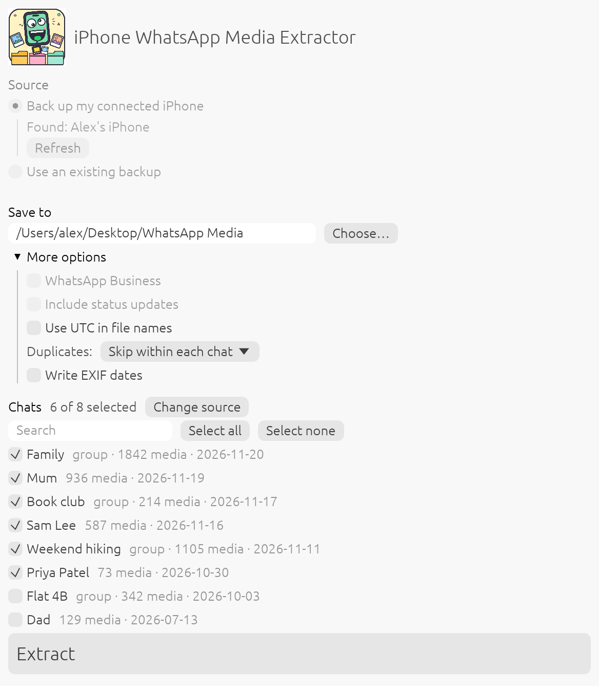
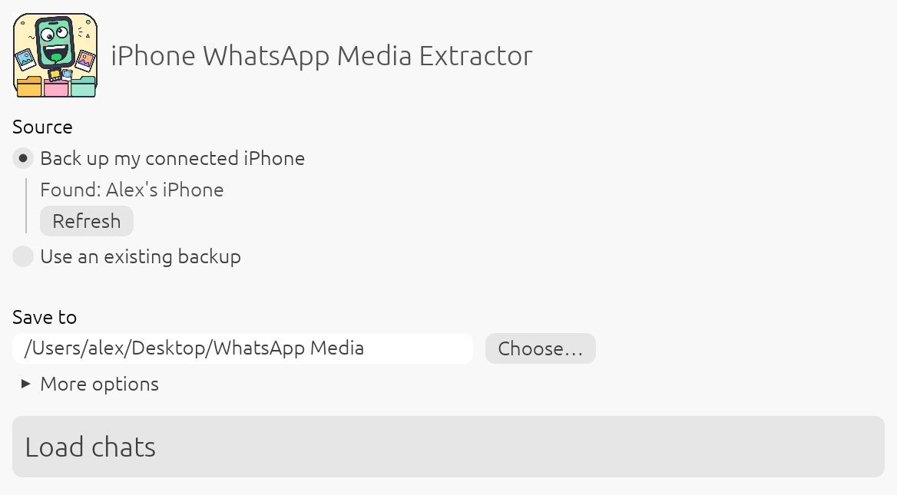
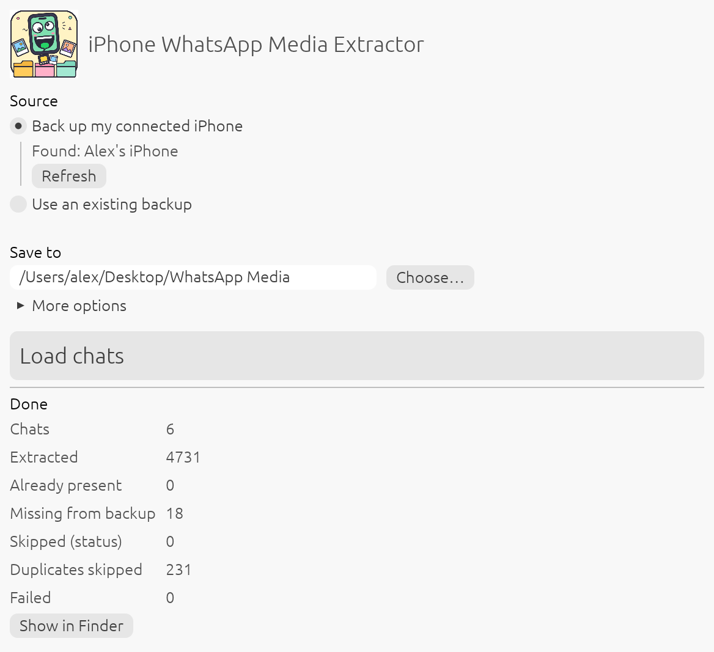

<p align="center">
  
</p>

<h1 align="center">iPhone WhatsApp Media Extractor</h1>

A free, open-source Mac app and command-line tool that pulls the photos, videos, voice notes and documents out of WhatsApp on your iPhone. Everything lands in one folder per chat, and every file is named and dated by when it was sent.

It only extracts media. There is no chat viewer.

<p align="center">
  
</p>

## Install

```sh
curl -fsSL https://raw.githubusercontent.com/phanshiyu/iphone-whatsapp-media-extractor/main/install.sh | sh
```

To update, run the same command again. To remove everything:

```sh
curl -fsSL https://raw.githubusercontent.com/phanshiyu/iphone-whatsapp-media-extractor/main/install.sh | sh -s -- --uninstall
```

The app goes in `/Applications` (or `~/Applications` if that isn't writable) and the `iphone-whatsapp-media-extractor` command in `/usr/local/bin` (or `~/.local/bin`). If `libimobiledevice` is missing, the installer adds it with Homebrew. No sudo. Pass `--no-deps` to skip Homebrew, or `--cli-only` to skip the app.

## Using the app

Open it from Applications or Launchpad.

1. Pick a source: **Back up my connected iPhone** (plug it in, unlock it, tap Trust) or **Use an existing backup** from Finder.
2. Choose where to **Save to**, and type the backup password if it asks.
3. Click **Load chats**.
4. Tick the chats you want and click **Extract**. Everything is ticked to start with, and there's a search box.
5. Click **Show in Finder**.

<p align="center">
  
  
</p>

**More options** has the WhatsApp Business switch, status updates, UTC file names, and a **Duplicates** setting that skips identical files within each chat or across all of them.

## What you get

```
WhatsApp Media/
├── Alice/
│   ├── 2023-03-05_23-59-59_001.jpg
│   ├── 2023-03-05_23-59-59_002.jpg
│   └── 2023-03-06_08-12-40_001.opus
└── Book Club/
    ├── 2023-04-02_19-30-05_001_Me.mp4
    └── 2023-04-02_19-31-12_001_Bob.jpg
```

Names are `YYYY-MM-DD_HH-MM-SS_NNN`, in local time. `NNN` counts files sent in the same second, so sorting by name is chronological. Group chats get the sender on the end. File dates are set to the send time too. Run it again on the same folder and anything already there is skipped.

## Command line

Back up the connected iPhone, extract, and delete the temporary backup:

```sh
iphone-whatsapp-media-extractor ~/WhatsAppMedia
```

Or read a backup you already have:

```sh
iphone-whatsapp-media-extractor ~/WhatsAppMedia \
  --backup "$HOME/Library/Application Support/MobileSync/Backup/<UDID>"
```

| Flag | What it does |
| --- | --- |
| `--backup <DIR>` | Use an existing backup instead of backing up the phone |
| `--keep-backup <DIR>` | Keep the device backup here, so later runs are incremental |
| `--work-dir <DIR>` | Put the temporary backup on another disk |
| `--udid <UDID>` | Pick a device when several are connected |
| `--password <PW>` | Backup password (or set `IWME_PASSWORD`; it prompts otherwise) |
| `--list-chats` | Print the chats that have media and exit |
| `--chat <NAME_OR_JID>` | Only this chat (repeatable) |
| `--exclude-chat <NAME_OR_JID>` | Skip this chat (repeatable) |
| `--dedupe <MODE>` | `off` (default), `per-chat` or `all-chats` |
| `--business` | Read WhatsApp Business instead of WhatsApp |
| `--include-status` | Include status updates |
| `--utc` | Use UTC in file names |
| `--exif` | Also write date tags, if `exiftool` is installed |
| `--dry-run` | Show what would happen without writing anything |

On other platforms, or to build the CLI yourself: `cargo install --git https://github.com/phanshiyu/iphone-whatsapp-media-extractor iphone-whatsapp-media-extractor`

## Good to know

Full Disk Access is only needed when reading an existing Finder backup, which macOS keeps under `~/Library/Application Support/MobileSync/Backup`. The app shows a banner with an **Open Settings** button. Turn it on for the app, then quit and reopen it. For the CLI, grant it to your terminal. Backing up a connected iPhone doesn't need it.

The app is ad-hoc signed, not notarized. Installed with the command above it opens normally. If you download the `.dmg` or `.zip` from Releases instead, macOS may refuse to open it. Go to System Settings > Privacy & Security and click **Open Anyway**.

An encrypted backup asks for the password you set for iPhone backups in Finder, not your Apple ID password.

Backing up a connected iPhone copies the whole phone to a temporary folder, so you need free disk space roughly equal to the storage the phone uses. The folder is deleted afterwards, even if you cancel. If your startup disk is tight, use `--work-dir`.

WhatsApp Business is a separate app on the phone, so turn on **WhatsApp Business** under More options (or pass `--business`) to read it.

## Development

The workspace has three crates: `crates/core` (the library), `crates/cli` and `crates/app` (the egui GUI).

```sh
cargo fmt --all --check
cargo clippy --workspace --all-targets --all-features -- -D warnings
cargo test --workspace
cargo run -p iwme-app
```

Tests use synthetic backups, so you don't need real phone data. The screenshots in this README are generated with `cargo test -p iwme-app --test screenshots -- --ignored`.

Renovate keeps dependencies patched, and a daily workflow cuts a patch release when `main` has changed and CI is green.

## License

MIT. Not affiliated with WhatsApp or Apple.
